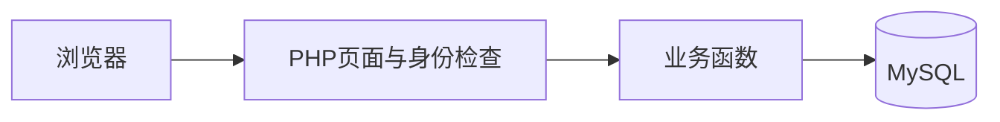
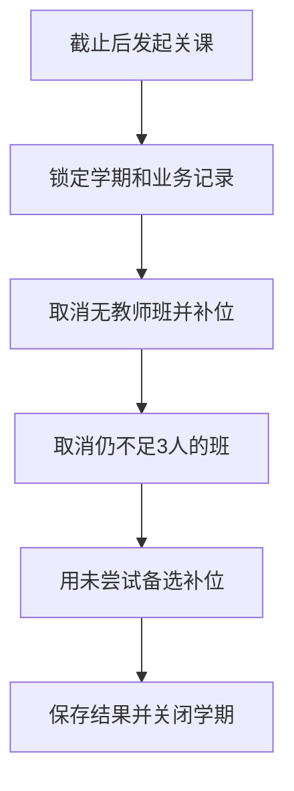

# 课程注册系统设计文档

更新：2026-10-11。运行环境：PHP 8.0+、MySQL 8.0.16+。

## 1. 结构

浏览器提交表单，PHP校验身份和业务规则，通过PDO读写MySQL，再返回页面。

| 模块 | 主要文件 |
| --- | --- |
| 登录与权限 | `Page/auth.php`、`login.php`、`password.php` |
| 课程查询 | `data/catalog_runtime.php`、`courses.php`、`course.php` |
| 学生选退课、课表 | `student_registration_db.php`、`selection.php`、`schedule.php` |
| 教师任教、成绩 | `teacher_claim_db.php`、`teacher_grades_db.php` |
| 草稿、整份删除、名单 | `registration_extras.php`、`roster.php` |
| 任教资格、计费 | `billing_db.php`、`admin_extras.php` |
| 只读课程定义 | `data/catalog_provider.php`、`catalog_api.php` |
| 人员资料、关课 | `admin_people_db.php`、`admin_closure_db.php` |

未设置数据库用户时，只演示课程、选课和认领，数据保存在本次会话。正式数据库模式的名额和业务记录由各账号共享。

## 2. 数据库

默认数据库为`course_registration`，主机和账号由`CR_DB_*`配置。完整字段、索引和外键见[建表脚本](database/schema.sql)。

| 表 | 主要用途与约束 |
| --- | --- |
| `users`、`person_profiles` | 账号、角色、启用状态和人员资料；账号、证件号唯一，资料含版本号 |
| `semesters` | 起止时间；开放、关闭中、已关闭 |
| `courses`、`course_prerequisites` | 课程定义（含所属院系）和先修关系 |
| `offerings`、`offering_times` | 学期教学班、教师、容量和多段上课时间；容量不超过10 |
| `teacher_claims` | 教师主动认领来源，区别于预先安排 |
| `selection_choices` | 首选与有顺序的备选 |
| `enrollments`、`grades` | 实际占座及对应成绩；只有有效占座计入人数 |
| `offering_closure_results`、`closure_backup_attempts` | 关课结果、备选尝试顺序及原因 |

| `selection_drafts` | 学生与学期唯一的JSON草稿，不产生占座 |
| `teacher_qualifications` | 教师与课程资格，认领时在锁内检查 |
| `billing_outbox` | 学生与学期唯一的最终课表快照，保存发送状态和尝试次数 |

关系：课程和学期各对应多个教学班；学生通过占座记录关联教学班，成绩关联占座记录；教学班包含多个时间段。

## 3. 选课与关课

选课在事务中检查开放期，锁定学生和按编号排序的教学班，读取最新人数，再校验重复、先修和时间冲突。更新首选与备选，仅新增首选占座，移除的首选释放名额。失败整体回滚，退课使用同样的开放期约束。

学生按方案最早保存时间、编号处理；备选按原顺序，每个最多尝试一次。每次检查容量、先修、重复课程和时间。已补入的班若停开，释放占座、恢复备选顺序并记录原因。整个关课在一次事务中完成，重复关闭只读取结果。

草稿单独保存；正式提交成功时删除草稿。整份删除锁定学生、学期和教学班后，在一个事务中释放占座并清空方案和草稿。名单页只读本人任教的教学班。

关课事务同时生成计费快照，事务提交后模拟发送。失败状态保留供教务重试；行锁及学生/学期唯一键防止重复处理。`CR_BILLING_MODE=fail`模拟接收失败，默认`success`模拟成功；真实接收端尚未接入。

课程定义默认读取本地库；`CR_CATALOG_FILE`可指定从只读接口导出的JSON快照。课名、描述和所属院系由目录提供，先修关系、任教、占座和状态仍由注册库管理。目录缺失或格式错误时返回受控错误。`catalog_api.php`需要登录，只接受GET。

## 4. 权限与页面

身份取自服务端会话，修改表单使用POST和令牌，SQL使用预处理，页面文字转义。学生只能操作本人记录；教师只能维护本人已确认开设、学期已关闭的班级成绩。人员编辑检查版本，删除须确认，有关联记录时不物理删除。停用或重置密码后旧会话失效。

按本地演示要求，密码以明文保存，可由教务查询；沿用`users.password_hash`字段名。旧哈希仍可登录，成功后转换，未知旧密码只能重置。

页面保留表单、主要操作和错误提示；规则、备选和说明默认折叠，课程列表不再重复显示人数进度。所属院系只在课程详情展示；未填写显示“未填写”，旧JSON目录可省略该字段。启动与数据导入见[README](README.md)。
