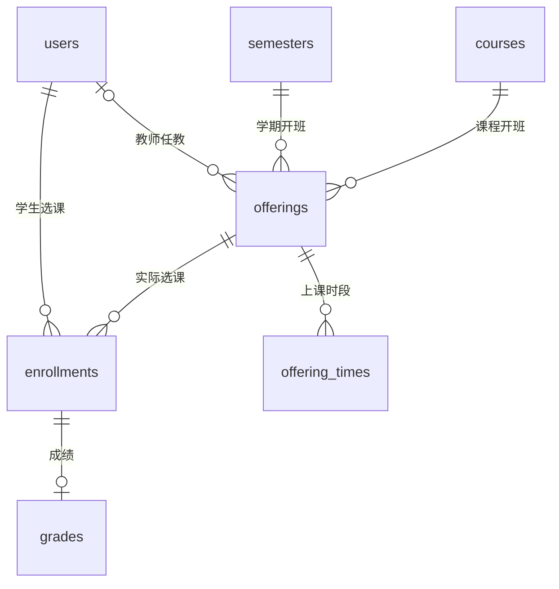
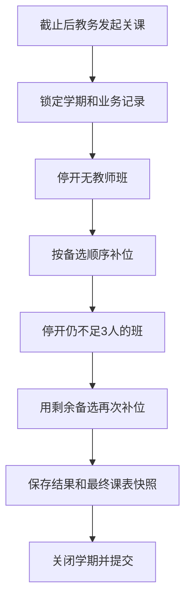

# 课程注册系统设计文档

日期：2026-10-11。运行环境为PHP 8.0及以上、MySQL 8.0.16及以上。

## 1. 总体设计

系统采用浏览器/服务器结构。浏览器展示页面并提交表单，PHP处理身份验证和业务规则，MySQL保存账号、课程、选课和成绩等数据。

| 运行模式 | 数据来源 | 用途 |
| --- | --- | --- |
| 会话演示模式 | 样例课程和登录会话 | 未配置数据库用户时，演示课程查询、选课和认领 |
| 数据库模式 | MySQL共享记录 | 多账号使用、成绩维护和教务处理 |

以下设计对应当前实现。计费接收端采用模拟方式，课程目录来自本地数据库或JSON快照；学费计算和真实外部系统接入尚未实现，性能与长期运行指标尚未验证。

启动与数据库导入方法见[README](README.md)。

## 2. 功能模块

以下路径以`Page/`为起点。页面接收请求，业务文件检查规则并保存数据。

| 模块 | 主要文件 | 作用 |
| --- | --- | --- |
| 登录与权限 | `auth.php`、`login.php`、`logout.php`、`password.php` | 登录、退出、角色检查和密码验证 |
| 课程查询 | `index.php`、`courses.php`、`course.php` | 首页、筛选和课程详情 |
| 课程数据 | `data/catalog_runtime.php`、`data/catalog_provider.php` | 读取数据库或JSON目录 |
| 学生选课 | `student_registration_db.php`、`selection.php`、`schedule.php` | 选课、退课和课表 |
| 草稿与删除 | `registration_extras.php` | 保存草稿和清空本学期方案 |
| 教师任教 | `teacher_claim_db.php`、`teaching.php`、`roster.php` | 认领、取消和学生名单 |
| 成绩管理 | `teacher_grades_db.php`、`grade_entry.php`、`grades.php` | 教师维护、学生查询 |
| 人员管理 | `admin_people_db.php`、`admin_people.php` | 查找、新增、编辑、删除和停用 |
| 关闭选课 | `admin_closure_db.php`、`admin_closure.php` | 停开、备选补位和结果查询 |
| 资格与模拟计费 | `billing_db.php`、`admin_extras.php` | 任教资格、模拟发送和重试 |
| 只读目录 | `catalog_api.php` | 登录后导出课程JSON |
| 共用页面 | `partials/`、`assets/css/style.css` | 页头、页脚和样式 |

## 3. 数据库设计

默认数据库名为`course_registration`，使用utf8mb4保存中文，连接信息支持根目录`config.local.php`和`CR_DB_*`环境变量。`CR_DEMO_MODE=1`优先强制演示；否则，设置了`CR_DB_USER`时整组采用环境变量，未设置时读取本机配置，无数据库用户时进入会话演示。配置字段类型和端口范围在连接前校验。本机配置不提交仓库。完整字段和约束见[建表脚本](database/schema.sql)。

### 3.1 数据表

| 表名 | 保存内容 |
| --- | --- |
| `users` | 账号、姓名、角色、密码和启用状态 |
| `person_profiles` | 出生日期、证件号、人员状态、院系、毕业日期和资料版本 |
| `semesters` | 学期、选课起止时间和状态 |
| `courses` | 课程编号、名称、简介和院系 |
| `course_prerequisites` | 课程与先修课程关系 |
| `offerings` | 教学班、教师、地点、容量和状态 |
| `offering_times` | 教学班的上课时段 |
| `teacher_claims` | 教师主动认领记录 |
| `teacher_qualifications` | 教师可以任教的课程 |
| `selection_choices` | 学生的首选、备选和顺序 |
| `enrollments` | 实际选课、来源和退选状态 |
| `grades` | 对应选课记录的成绩 |
| `selection_drafts` | 未正式提交的方案 |
| `offering_closure_results` | 教学班关课结果和原因 |
| `closure_backup_attempts` | 备选尝试顺序和结果 |
| `billing_outbox` | 最终课表快照及模拟发送状态 |

### 3.2 主要数据关系

一门课程可以开多个教学班，一个班可以有多个上课时段。学生通过选课记录关联教学班，成绩关联具体选课记录。学生、教师和教务员共用账号表，通过角色区分。

选课方案与实际占座分开保存：方案包含首选和备选，只有有效选课记录计入人数。人员资料关联账号，任教资格关联教师与课程，草稿和模拟计费记录关联学生与学期。

账号、证件号和学生与教学班的选课组合不能重复。外键保护数据关系，容量和4+2数量等规则由PHP检查。

### 3.3 主要状态

| 对象 | 状态变化 | 说明 |
| --- | --- | --- |
| 学期 | 开放 → 关闭中 → 已关闭 | 关课失败恢复原状态；“关闭中”只在关课事务内使用 |
| 教学班 | 开放 → 确认开设或停开 | 无教师或补位后不足3人时停开 |
| 选课记录 | 有效 → 退选或取消 | 退课、整份删除标为退选；停开标为取消，均不计入人数 |
| 草稿 | 保存或覆盖 → 清除 | 不占座，正式提交成功或整份删除时清除 |
| 模拟发送 | 待发送 → 成功或失败 | 失败可手动重试，成功记录不重复发送 |

开放期重选可恢复原退选记录。整份删除清除方案和草稿，保留已标为退选的历史选课记录；项目没有重新开放已关闭学期的页面。

## 4. 主要业务处理

### 4.1 学生选课

1. 检查登录身份、表单令牌、4个首选和2个备选。
2. 开始事务，读取并锁定学期、学生及相关教学班。
3. 读取最新人数，检查课程重复、先修、首选名额及首选之间的上课时间。
4. 保存方案，释放移除课程的名额，为新增首选占座。
5. 清除草稿并提交事务，返回更新后的课表。

事务保证上述修改全部完成或全部撤销。教学班按编号顺序锁定，保存前重新读取人数，防止两个学生同时占用最后一个名额。重新提交时扣除本人已有占座，不重复增加人数。

开放期按北京时间判断：学期状态为开放，且当前时间在开始和截止之间，包含起止时刻。首选之间检查全部时段，端点相接不算冲突；备选不占座，可以满额或与首选时间冲突，补位时再检查实际课表。

草稿最多保存4个首选、2个备选，可不完整或暂有冲突，但非空班级编号必须存在。失败提交保留原课表和草稿。退课和整份删除也检查开放期，整份删除需要页面确认。

### 4.2 教师任教与成绩

认领前检查教师角色、任教资格、开放期、已有教师和全部上课时段。未设置上课时间，或与本人已有任教安排冲突的教学班不能认领。

主动认领同时保存来源记录，取消时只允许取消本人主动认领的班，不能取消预先安排的任教。名单只显示本人教学班的有效选课学生。

成绩只能由任课教师在学期已关闭、班级确认开设后维护，允许A、B、C、D、F、I或留空。先修通过等级包括A—D，以及历史数据中的优秀、良好、中等、及格。学生只能查询自己的成绩。

### 4.3 人员资料

新增时检查账号、证件号和资料格式。编辑时比较资料版本，资料已被他人修改则拒绝覆盖，提示重新读取。

删除需要确认。有选课、任教等关联记录时拒绝删除，账号不会自动停用；教务员可以在编辑页手动停用。停用或重置密码后，旧会话失效。

### 4.4 关闭选课

关课要求当前时间严格晚于截止时刻。学生按当前保留方案的最早保存时间处理，时间相同时按学生编号排序。重新正式提交会重建方案并刷新保存时间，保存草稿不影响排序。

每个备选最多尝试一次，补位重新检查容量、先修、重复课程和时间。补入的班后来停开时，恢复其备选记录并释放名额，但不再次尝试。没有可用备选时保留实际课表，可以少于4门。

整个关课在一个事务中完成，失败全部撤销。重复关闭只显示原结果，不再次补位。

### 4.5 任教资格、模拟计费与课程目录

教务员授予或撤销任教资格。教师在未关闭学期中仍承担该课程时，不能撤销资格。

关课事务保存最终课表快照，提交后再模拟发送。发送失败不撤销已经完成的关课，教务可手动重试；成功记录不重复发送。`CR_BILLING_MODE=fail`模拟失败，默认`success`模拟成功。

课程定义默认来自本地数据库，也可通过`CR_CATALOG_FILE`指定JSON快照。先修、任教、人数和状态仍由注册库管理。`catalog_api.php`需要登录，只接受GET；快照缺失或格式错误时提示读取失败，院系为空时显示“未填写”。

## 5. 权限与错误处理

身份以登录会话为准。学生操作本人记录，教师操作本人任教范围，教务页面检查教务角色。修改使用POST和表单令牌，数据库查询使用预处理，页面文字进行转义。

业务错误提示数量、名额、先修或权限原因；数据库异常显示受控提示，不暴露连接信息。保存失败先回滚，再返回结果。

密码沿用`users.password_hash`字段，兼容明文和PHP密码哈希。`password.php`识别格式后，分别使用`hash_equals()`或`password_verify()`验证，登录不改变原存储值。哈希字符串不能作为登录密码。

人员页只显示密码状态，不展示或回填已有密码。编辑时密码留空保留原值，新增或重置使用`password_hash()`生成哈希。已有明文账号继续兼容，登录不自动转换；重置后旧会话失效。

## 6. 页面与验证

页面按角色提供入口，显示课程、课表、名单、成绩和教务结果。表单成功或失败均有提示，删除需要确认，较长的规则和说明可以折叠。

新库建表后导入演示数据，旧库按缺失内容执行对应升级脚本。建表不会自动修改旧字段；院系升级只补空值，不覆盖已填写内容。

各模块的需求和测试入口见[测试计划第5节](课程注册系统测试计划.md#5-需求与测试入口对应)，验证结果见[测试报告](课程注册系统测试报告.md)。页面布局、键盘操作和窄屏显示另行进行人工检查。
