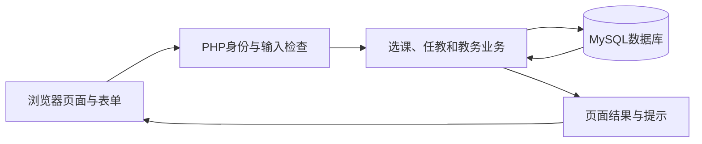
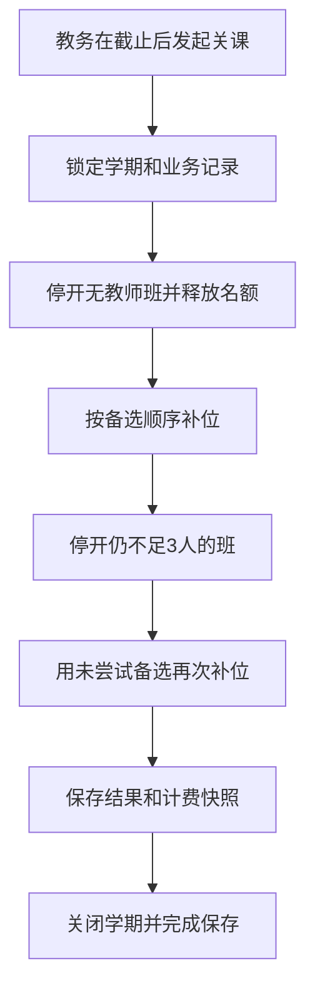

# 课程注册系统设计文档

更新日期：2026-10-11。运行环境为PHP 8.0及以上、MySQL 8.0.16及以上。

## 1. 设计目标与总体结构

系统通过网页完成课程注册业务。设计重点是操作清楚、权限明确、数据一致：用户可以看到操作结果，服务端检查业务规则，数据库保存共享记录。

浏览器负责展示页面和提交表单，PHP负责判断身份、检查规则和处理业务，MySQL负责保存账号、课程、选课和成绩等数据。

例如，学生点击提交选课后，服务端先读取登录身份，再检查选课期、课程数量、时间和名额。检查通过才保存，最后返回更新后的页面；失败时返回原因。

### 1.1 运行模式

| 模式 | 数据来源与保存 | 使用范围 |
| --- | --- | --- |
| 会话演示模式 | 样例课程和登录会话中的记录 | 未设置数据库用户时，演示课程、选课和认领 |
| 数据库模式 | MySQL中的共享业务记录 | 多账号选课、任教、成绩和教务处理 |

数据库模式中，各账号看到的名额来自同一份数据。配置变化后需重启PHP服务，具体启动方法见[README](README.md)。

## 2. 功能模块与页面

下表文件路径均以`Page/`目录为起点。

| 模块 | 主要文件 | 处理内容 |
| --- | --- | --- |
| 登录与权限 | `auth.php`、`login.php`、`logout.php`、`password.php` | 登录验证、会话检查、退出和密码兼容 |
| 首页与课程 | `index.php`、`courses.php`、`course.php` | 导航、筛选和课程详情 |
| 课程数据 | `data/catalog_runtime.php`、`data/catalog_provider.php` | 读取数据库课程或JSON快照 |
| 学生选课 | `student_registration_db.php`、`selection.php`、`schedule.php` | 保存方案、占座、退课和课表 |
| 草稿与整份删除 | `registration_extras.php` | 草稿保存、读取和整份清空 |
| 教师任教 | `teacher_claim_db.php`、`teaching.php`、`roster.php` | 认领、取消和本人学生名单 |
| 成绩管理 | `teacher_grades_db.php`、`grade_entry.php`、`grades.php` | 教师维护与学生查询成绩 |
| 人员资料 | `admin_people_db.php`、`admin_people.php` | 查找、新增、编辑、删除及停用 |
| 关闭选课 | `admin_closure_db.php`、`admin_closure.php` | 停开、补位和结果查询 |
| 资格与计费 | `billing_db.php`、`admin_extras.php` | 任教资格维护和模拟计费发送 |
| 只读目录 | `catalog_api.php` | 登录后导出课程定义 |
| 共用页面 | `partials/`、`assets/css/style.css` | 页头、页脚和样式 |

页面处理请求，业务文件负责检查和保存。共用身份检查、数据库连接和目录读取，避免不同模块各自维护一套规则。

## 3. 数据库设计

默认数据库为`course_registration`，连接信息由`CR_DB_*`环境变量配置。数据库使用utf8mb4保存中文。完整字段、索引和外键见[建表脚本](database/schema.sql)。

### 3.1 主要数据表

| 表名 | 主要内容 | 关键规则 |
| --- | --- | --- |
| `users` | 账号、姓名、角色、明文或哈希密码和启用状态 | 账号唯一，登录保留密码格式，角色区分学生、教师、教务 |
| `person_profiles` | 出生日期、证件号、人员状态、院系和毕业日期 | 证件号唯一，版本号用于检查编辑冲突 |
| `semesters` | 学期名称、选课起止时间和状态 | 状态为开放、关闭中或已关闭 |
| `courses` | 课程编号、名称、简介和院系 | 课程编号唯一 |
| `course_prerequisites` | 课程与先修课程关系 | 同一先修关系不能重复 |
| `offerings` | 学期教学班、教师、地点、容量和状态 | 容量为1—10，状态为开放、确认或停开 |
| `offering_times` | 教学班的星期和起止时间 | 一个班可有多个时段，开始早于结束 |
| `teacher_claims` | 教师主动认领记录 | 区别于预先安排的任教 |
| `teacher_qualifications` | 教师可任教的课程 | 教师与课程组合唯一 |
| `selection_choices` | 学生的首选、备选及顺序 | 同一学期不重复选择同一班 |
| `enrollments` | 实际占座、来源和退课状态 | 只有有效记录计入人数 |
| `grades` | 对应占座记录的成绩 | 未录入时为空 |
| `selection_drafts` | 学生本学期的JSON草稿 | 学生与学期组合唯一，不占座 |
| `offering_closure_results` | 关课结果、原人数和停开原因 | 保存每个教学班的处理结果 |
| `closure_backup_attempts` | 备选尝试顺序与结果 | 记录补位成功或失败原因 |
| `billing_outbox` | 最终课表快照、发送状态和次数 | 学生与学期组合唯一 |

### 3.2 数据关系

一门课程在不同学期可以开设多个教学班，一个教学班可以包含多个上课时段。学生通过占座记录关联教学班，成绩关联具体占座记录。

选课方案和实际占座分开保存：方案包含首选与备选，实际占座说明学生当前在哪些班上课。因此，保存备选和草稿不会直接增加人数。

人员资料关联账号，任教资格关联教师与课程，计费快照关联学生与学期。外键保护关联关系，唯一约束防止重复账号、重复选课和重复计费记录。

## 4. 关键业务设计

### 4.1 提交选课

选课保存使用数据库事务，即把多项修改作为一次完整操作：全部成功才保存，中途失败则恢复。具体步骤如下：

1. 检查当前账号是学生，学期仍在开放期。
2. 锁定学生记录，并按教学班编号顺序锁定相关记录。
3. 读取最新人数，检查4个首选、2个备选、重复课程、先修和所有时间段。
4. 更新方案，新增首选占座，释放被移除首选的名额，保留备选顺序。
5. 清除已成功提交的草稿，完成保存并返回课表。

锁定记录是为了让同时操作同一名额的请求按顺序处理。例如，两名学生争最后一个名额时，后处理的请求读取最新人数，满额则拒绝。不能只依据浏览器显示的人数保存。

前端可提前提示数量和重复选择，最终仍由服务端检查。退课同样检查开放期，成功后释放对应名额。

### 4.2 草稿与整份删除

草稿独立保存在`selection_drafts`，可以不完整，不改变正式方案和占座。读取时使用当前学生和学期，保证不同学生之间隔离。正式提交仍重新校验，成功后删除草稿。

整份删除要求用户确认。服务端检查身份和开放期，锁定学生、学期及相关教学班，在同一事务中释放占座并清空本学期方案和草稿。重复删除不增加额外影响，中途失败则全部恢复。

### 4.3 教师认领与成绩

认领前检查教师角色、课程任教资格、开放期、教学班是否已有教师，以及所有上课时段是否冲突。缺少上课时间的教学班不能认领。

认领后同时保存教学班教师和主动认领来源。取消时检查来源，只允许取消本人主动认领的班。预先安排的任教不能由教师自行取消。

名单查询只返回当前教师本人教学班的学生。成绩保存检查学期已关闭、教学班已确认、教师归属和合法等级；学生成绩页只读取本人结果。

### 4.4 人员资料维护

新增人员时检查账号、证件号和资料格式。编辑页面携带资料版本号，保存时与最新版本比较；版本不同则提示资料已变化，避免后保存的人覆盖他人的修改。

删除前显示确认页面。有业务关联时拒绝删除并保留记录，教务员可通过编辑停用账号；无关联时完成删除。停用或重置密码后，原会话失效。

### 4.5 关闭选课

学生按方案最早保存时间和编号处理，备选按原顺序尝试，每个最多尝试一次。每次补位检查容量、先修、重复课程和时间冲突，记录成功或失败原因。

已补入的班后来停开时，释放占座并恢复对应备选记录。没有可用备选时保留实际课表。整个关课在一个事务中完成，失败全部恢复；重复关闭只读取已有结果。

### 4.6 模拟计费

关课事务中生成最终课表快照，保存成功后再模拟发送，避免关课失败却已发送结果。每名学生在每学期最多一条计费记录。

记录状态为待发送、失败或成功。失败保留错误和尝试次数，教务可重试；成功记录不重复发送。行锁和唯一约束共同防止重复处理。

`CR_BILLING_MODE=fail`模拟失败，默认`success`模拟成功。接收端采用模拟方式，发送内容为最终课表快照，不涉及费用计算和支付。

### 4.7 只读课程目录

默认读取本地数据库课程定义，也可通过`CR_CATALOG_FILE`指定JSON快照。课名、描述和院系来自目录，先修关系、任教、占座和状态仍由注册库管理。

`catalog_api.php`需要登录，只接受GET。快照缺失或格式错误时返回受控提示，旧快照可以省略院系。课程详情未取得院系时显示“未填写”。

## 5. 权限、输入与错误处理

身份来自服务端会话，不能直接相信请求中的角色或用户编号。学生只操作本人记录，教师只维护本人任教范围，教务页面检查对应角色。

修改表单使用POST和表单令牌，拒绝无效请求。数据库查询使用预处理，页面输出文字进行转义。数量、日期、成绩和编号等内容在服务端再次检查。

错误处理分两类：业务错误说明数量、名额、资格等原因；数据库异常返回受控错误，不直接暴露内部连接信息。事务失败时先恢复数据，再返回结果。

密码沿用`users.password_hash`字段，支持明文和PHP密码哈希。`password.php`通过`password_get_info()`识别格式：识别出的哈希交给`password_verify()`验证，明文使用`hash_equals()`准确比较。支持的哈希算法由PHP运行环境决定，包括bcrypt和环境支持的Argon2。

登录只验证，不更新密码字段。会话仍以原存储值生成校验标记，因此明文和哈希账号都能检查密码重置后的会话失效。哈希字符串本身不能作为登录密码。

人员页面显示明文或哈希状态，哈希不回填到密码输入框，留空保存时保留原值。新增或重置时保存输入的明文密码；已有哈希不会因登录或留空编辑改为明文。

## 6. 页面设计

| 页面类型 | 主要内容 | 使用要求 |
| --- | --- | --- |
| 登录与首页 | 角色选择、登录表单和导航 | 登录后显示对应入口 |
| 课程列表与详情 | 筛选、课程说明、教学班和院系 | 无结果有提示，详情字段清楚 |
| 学生选课与课表 | 首选、备选、草稿、提交和删除 | 操作结果明确，危险修改需要确认 |
| 教师任教与成绩 | 认领列表、学生名单和成绩表单 | 清楚区分可操作和无权限内容 |
| 教务页面 | 人员资料、关课结果、资格和计费 | 显示处理状态及失败原因 |

页面保留主要表单、按钮和结果提示，规则、备选与说明默认折叠，课程列表减少重复说明。院系只在课程详情展示。

布局、键盘操作、窄屏和折叠效果按[测试计划](课程注册系统测试计划.md)人工检查，自动网页检查验证内容与流程。

## 7. 初始化与验证

新库先执行建表脚本，空库可导入演示数据。已有库按需要执行人员资料、新增业务和院系升级脚本。重复建表不会自动修改旧字段，升级需使用对应脚本；院系升级仅补空值，不覆盖已填写内容。

开发时先验证正常流程，再检查错误输入、越权、名额竞争和事务失败。写入及故障测试使用临时库，结果记录在[测试报告](课程注册系统测试报告.md)。

计费与课程目录分别保留发送和读取接口，接入外部服务后进行接口联调。压力与持续运行测试按测试计划安排。
