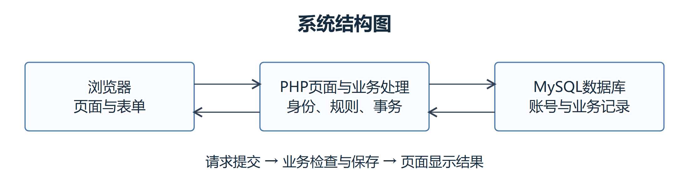
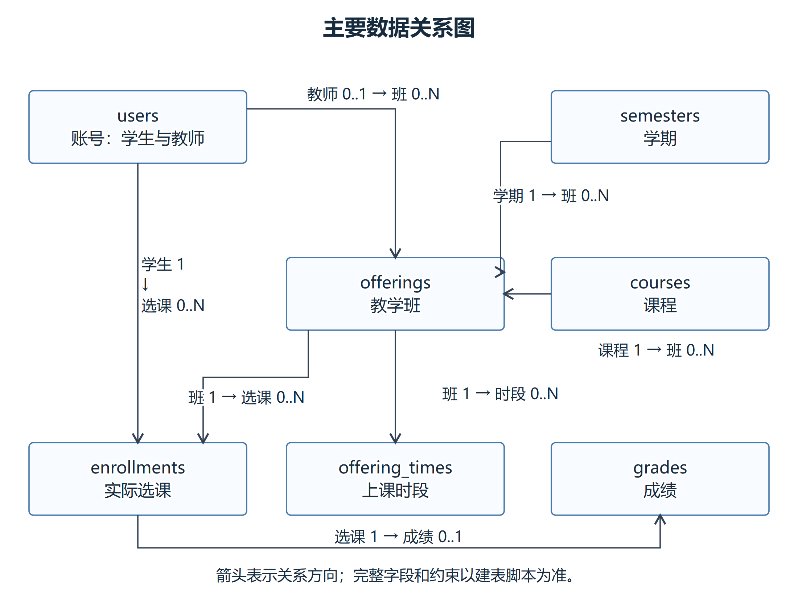
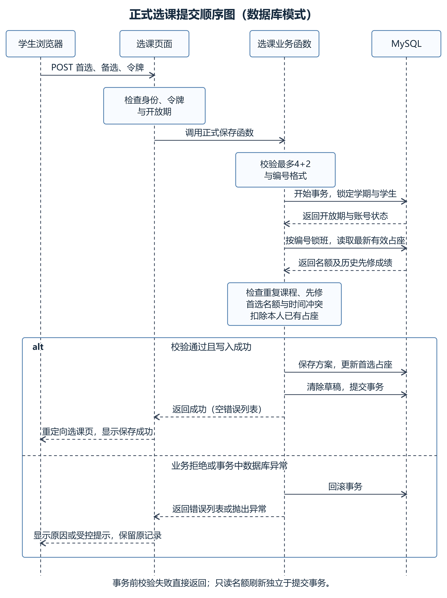
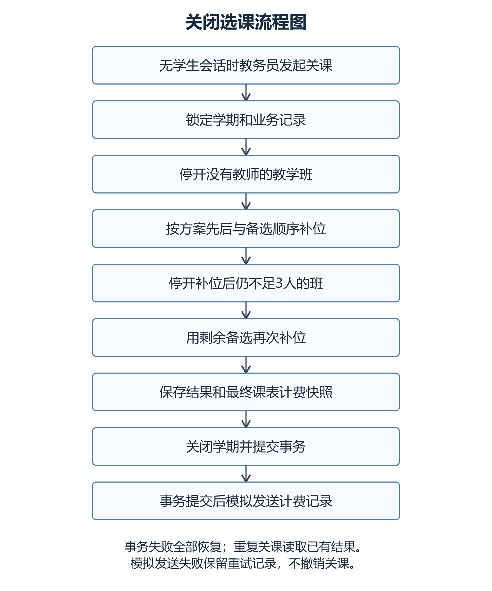

# 课程注册系统设计文档

日期：2026-10-12。运行环境为PHP 8.0及以上、MySQL 8.0.16及以上。

## 1. 总体设计

系统采用浏览器/服务器结构。浏览器展示页面并提交表单，PHP处理身份验证和业务规则，MySQL保存账号、课程、选课和成绩等数据。

图1 系统结构图。[矢量图](课程注册系统需求分析文档_media/系统结构图.svg) · [Mermaid源文件](课程注册系统需求分析文档_media/系统结构图.mmd)。

| 运行模式 | 数据来源 | 用途 |
| --- | --- | --- |
| 会话演示模式 | 样例课程和登录会话 | 未配置数据库用户时，演示课程查询、选课和认领 |
| 数据库模式 | MySQL共享记录 | 多账号使用、成绩维护和教务处理 |

图1表示数据库模式下的请求过程。浏览器向PHP页面提交请求，PHP完成身份和业务校验后访问MySQL，再将结果返回页面。浏览器不直接连接数据库；会话演示模式则在当前会话中保存演示状态，不能用于验证跨账号的数据一致性。

当前实现的计费接收端采用模拟方式，失败后手动重试；课程目录来自本地数据库或JSON快照。名额竞争测试用于验证分配正确性，性能结论需另以并发量和响应时间记录为依据。

启动与数据库导入方法见[README](README.md)。

## 2. 功能模块

以下路径以`Page/`为起点。页面接收请求，业务文件检查规则并保存数据。

| 模块 | 主要文件 | 作用 |
| --- | --- | --- |
| 登录与权限 | `auth.php`、`login.php`、`logout.php`、`password.php` | 登录、退出、角色检查和密码验证 |
| 课程查询 | `index.php`、`courses.php`、`course.php` | 首页、筛选和课程详情 |
| 课程数据 | `data/catalog_runtime.php`、`data/catalog_provider.php` | 读取数据库或JSON目录 |
| 学生选课 | `student_registration_db.php`、`selection.php`、`schedule.php` | 选课、退课和课表 |
| 草稿与删除 | `registration_extras.php` | 保存草稿和清空本学期方案 |
| 教师任教 | `teacher_claim_db.php`、`teaching.php`、`roster.php` | 认领、取消和学生名单 |
| 成绩管理 | `teacher_grades_db.php`、`grade_entry.php`、`grades.php` | 教师维护、学生查询 |
| 人员管理 | `admin_people_db.php`、`admin_people.php` | 查找、新增、编辑、删除和停用 |
| 关闭选课 | `admin_closure_db.php`、`admin_closure.php` | 停开、备选补位和结果查询 |
| 资格与模拟计费 | `billing_db.php`、`admin_extras.php` | 任教资格、模拟发送和重试 |
| 只读目录 | `catalog_api.php` | 登录后导出课程JSON |
| 名额刷新 | `selection_availability.php`、`assets/js/selection.js` | 学生查询当前名额与本人占座标记，更新选课提示 |
| 共用页面 | `partials/`、`assets/css/style.css` | 页头、页脚和样式 |

## 3. 数据库设计

默认数据库名为`course_registration`，使用utf8mb4保存中文，连接信息支持根目录`config.local.php`和`CR_DB_*`环境变量。`CR_DEMO_MODE=1`优先强制演示；否则，设置了`CR_DB_USER`时整组采用环境变量，未设置时读取本机配置，无数据库用户时进入会话演示。配置字段类型和端口范围在连接前校验。本机配置不提交仓库。完整字段和约束见[建表脚本](database/schema.sql)。

### 3.1 数据表

| 表名 | 保存内容 |
| --- | --- |
| `users` | 账号、姓名、角色、密码和启用状态 |
| `person_profiles` | 出生日期、证件号、人员状态、院系、毕业日期和资料版本 |
| `semesters` | 学期、选课起止时间和状态 |
| `courses` | 课程编号、名称、简介和院系 |
| `course_prerequisites` | 课程与先修课程关系 |
| `offerings` | 教学班、教师、地点、容量和状态 |
| `offering_times` | 教学班的上课时段 |
| `teacher_claims` | 教师主动认领记录 |
| `teacher_qualifications` | 教师可以任教的课程 |
| `selection_choices` | 学生的首选、备选和顺序 |
| `enrollments` | 实际选课、来源和退选状态 |
| `grades` | 对应选课记录的成绩 |
| `selection_drafts` | 未正式提交的方案 |
| `offering_closure_results` | 教学班关课结果和原因 |
| `closure_backup_attempts` | 备选尝试顺序和结果 |
| `billing_outbox` | 最终课表快照及模拟发送状态 |

#### 3.1.1 核心字段与约束

下面列出主要业务字段，完整结构以建表脚本为准。人员资料的必填规则见[需求分析第3.5节](课程注册系统需求分析文档.md#35-人员资料字段)。

| 表 | 主要字段及类型 | 键与约束 |
| --- | --- | --- |
| `users` | `id BIGINT UNSIGNED`，`username VARCHAR(64)`，`display_name VARCHAR(100)`，`role ENUM`，`password_hash VARCHAR(255)`，`is_active TINYINT(1)` | 自增主键`id`；账号唯一；角色为学生、教师或教务员；启用状态为0或1 |
| `person_profiles` | `user_id BIGINT UNSIGNED`，出生及毕业日期为`DATE`，证件号及状态为`VARCHAR(32)`，院系为`VARCHAR(100)`，`revision BIGINT UNSIGNED` | `user_id`同时为主键和账号外键；证件号唯一；学生与教师的必填项由PHP分别校验 |
| `semesters` | `id BIGINT UNSIGNED`，`name VARCHAR(100)`，起止时间及关闭时间为`DATETIME`，`status ENUM` | 自增主键；学期名唯一；开始时间必须早于截止时间 |
| `courses` | `code VARCHAR(32)`，`name VARCHAR(100)`，`description TEXT`，`department VARCHAR(100)` | 课程编号为主键；院系允许空字符串，页面显示“未填写” |
| `offerings` | `id VARCHAR(32)`，`course_code VARCHAR(32)`，学期及教师编号为`BIGINT UNSIGNED`，`capacity TINYINT UNSIGNED`，`status ENUM` | 教学班编号为主键；关联课程、学期和教师；教师可为空；容量限制为1—10 |
| `offering_times` | `id BIGINT UNSIGNED`，`offering_id VARCHAR(32)`，`weekday TINYINT UNSIGNED`，起止时间为`TIME` | 自增主键；教学班外键；星期为1—7，开始时间早于结束时间 |
| `selection_choices` | `id BIGINT UNSIGNED`，学生及学期编号为`BIGINT UNSIGNED`，教学班编号为`VARCHAR(32)`，`kind ENUM`，`choice_rank TINYINT UNSIGNED` | 自增主键；同一学生同学期的教学班及同类顺位分别唯一；首选顺位1—4，备选1—2 |
| `enrollments` | `id BIGINT UNSIGNED`，`student_id BIGINT UNSIGNED`，`offering_id VARCHAR(32)`，`status ENUM`，`source ENUM` | 自增主键；学生与教学班组合唯一；只有`active`状态占名额 |
| `grades` | `enrollment_id BIGINT UNSIGNED`，`grade_value VARCHAR(8)` | 选课记录编号为主键及外键；成绩等级由PHP校验，新成绩使用A、B、C、D、F或I；清空时将`grade_value`保存为NULL，保留选课关联 |

### 3.2 主要数据关系

图2选取账号、课程、教学班、实际选课与成绩之间的主要关系。连线两端表示一条记录可以关联的数量；方案、草稿及关课日志等辅助表见第3.1节。

图2 主要数据关系图。[矢量图](课程注册系统需求分析文档_media/主要数据关系图.svg) · [Mermaid源文件](课程注册系统需求分析文档_media/主要数据关系图.mmd)。

一门课程可以开多个教学班，一个班可以有多个上课时段。学生通过选课记录关联教学班，成绩关联具体选课记录。学生、教师和教务员共用账号表，通过角色区分。

选课方案与实际占座分开保存：方案包含首选和备选，只有有效选课记录计入人数。人员资料关联账号，任教资格关联教师与课程，草稿和模拟计费记录关联学生与学期。

账号、证件号和学生与教学班的选课组合不能重复。外键保护数据关系，数据库限制容量为1—10，PHP进一步检查有效人数不超过容量和4+2方案数量。最低开班人数为3，与可配置容量上限分别判断。

### 3.3 主要状态

| 对象 | 状态变化 | 说明 |
| --- | --- | --- |
| 学期 | 开放 → 关闭中 → 已关闭 | 关课失败恢复原状态；“关闭中”只在关课事务内使用 |
| 教学班 | 开放 → 确认开设或停开 | 无教师或补位后不足3人时停开 |
| 选课记录 | 有效 → 退选或取消 | 退课、整份删除标为退选；停开标为取消，均不计入人数 |
| 草稿 | 保存或覆盖 → 清除 | 不占座，正式提交成功或整份删除时清除 |
| 模拟发送 | 待发送 → 成功或失败 | 失败可手动重试，成功记录不重复发送 |

开放期重选可恢复原退选记录。整份删除清除方案和草稿，保留已标为退选的历史选课记录；项目没有重新开放已关闭学期的页面。

## 4. 主要业务处理

### 4.1 学生选课

1. 检查登录身份、表单令牌、4个首选和2个备选。
2. 开始事务，读取并锁定学期、学生及相关教学班。
3. 读取最新人数，检查课程重复、先修、首选名额及首选之间的上课时间。
4. 保存方案，释放移除课程的名额，为新增首选占座。
5. 清除草稿并提交事务，页面重定向到选课页显示成功提示，学生可继续查看课表。

事务保证上述修改全部完成或全部撤销。教学班按编号顺序锁定，保存前重新读取人数，防止两个学生同时占用最后一个名额。重新提交时扣除本人已有占座，不重复增加人数。

开放期按北京时间判断：学期状态为开放，且当前时间在开始和截止之间，包含起止时刻。首选之间检查全部时段，端点相接不算冲突；备选不占座，可以满额或与首选时间冲突，补位时再检查实际课表。

草稿最多保存4个首选、2个备选，可不完整或暂有冲突，但非空班级编号必须存在。失败提交保留原课表和草稿。退课和整份删除也检查开放期，整份删除需要页面确认。

#### 4.1.1 正式提交顺序

下图对应UC03在数据库模式下的正式提交。页面先检查身份、表单令牌与开放期，业务函数再检查4+2数量及编号格式；通过后才开启事务。事务内再次检查开放期、学生状态及最新占座。

图3 选课提交顺序图。校验失败在写入前返回；事务内业务拒绝或数据库异常均回滚。保存成功跳转回选课页，查看课表是后续操作。名额定时刷新是独立的只读请求，不参与提交事务。

[矢量图](课程注册系统需求分析文档_media/选课提交顺序图.svg) · [Mermaid源文件](课程注册系统需求分析文档_media/选课提交顺序图.mmd)。相关测试为T04—T07、T16，具体入口见[测试计划第5节](课程注册系统测试计划.md#5-需求与测试入口对应)。

### 4.2 教师任教与成绩

认领前检查教师角色、任教资格、开放期、已有教师和全部上课时段。未设置上课时间，或与本人已有任教安排冲突的教学班不能认领。

主动认领同时保存来源记录，取消时只允许取消本人主动认领的班，不能取消预先安排的任教。名单只显示本人教学班的有效选课学生。

成绩只能由任课教师在学期已关闭、班级确认开设后维护，允许A、B、C、D、F、I或留空。先修通过等级包括A—D，以及历史数据中的优秀、良好、中等、及格。学生只能查询自己的成绩。

### 4.3 人员资料

新增时检查账号、证件号和资料格式。编辑时比较资料版本，资料已被他人修改则拒绝覆盖，提示重新读取。

删除需要确认。有选课、任教等关联记录时拒绝删除，账号不会自动停用；教务员可以在编辑页手动停用。停用或重置密码后，旧会话失效。

### 4.4 关闭选课

图4对应UC09。先停开无教师的教学班并释放名额，再为学生补位；完成这一轮补位后，才判断教学班是否达到3人的最低开班人数。这样可避免将能够补足人数的教学班提前停开。

图4 关闭选课流程图。[矢量图](课程注册系统需求分析文档_media/关闭选课流程图.svg) · [Mermaid源文件](课程注册系统需求分析文档_media/关闭选课流程图.mmd)。

关课要求当前时间严格晚于截止时刻。学生按当前保留方案的最早保存时间处理，时间相同时按学生编号排序。重新正式提交会重建方案并刷新保存时间，保存草稿不影响排序。

每个备选最多尝试一次，补位重新检查容量、先修、重复课程和时间。补入的班后来停开时，恢复其备选记录并释放名额，但不再次尝试。没有可用备选时保留实际课表，可以少于4门。

整个关课在一个事务中完成，失败全部撤销。重复关闭只显示原结果，不再次补位。

### 4.5 任教资格、模拟计费与课程目录

教务员授予或撤销任教资格。教师在未关闭学期中仍承担该课程时，不能撤销资格。

关课事务保存最终课表快照，提交后再模拟发送。发送失败不撤销已经完成的关课，教务员可手动重试；成功记录不重复发送。`CR_BILLING_MODE=fail`模拟失败，默认`success`模拟成功。

课程定义默认来自本地数据库，也可通过`CR_CATALOG_FILE`指定JSON快照。先修、任教、人数和状态仍由注册库管理。`catalog_api.php`需要登录，只接受GET；快照缺失或格式错误时提示读取失败，院系为空时显示“未填写”。

### 4.6 核心接口与处理结果

以下写入入口使用普通网页表单提交。名额查询使用第4.7节的只读JSON接口。`PDO`由页面建立连接后传入，操作人的编号来自登录会话，学期编号来自当前学期配置，均不接受页面参数替换。所有写入入口检查角色和表单令牌。

| 操作与入口 | 主要表单参数 | 权限与结果 |
| --- | --- | --- |
| 提交选课：`POST selection.php` | `primary[]`、`backup[]`、`token`；`action=draft`仅保存草稿 | 学生本人、开放期；正式提交成功跳转到`selection.php?saved=1`，失败保留原方案并显示原因 |
| 退课：`POST schedule.php` | `id`、`token`；`action=delete`为整份删除，需另传`confirm=yes` | 学生本人、开放期；单课退课成功跳转到`schedule.php?removed=1`，整份删除成功跳转到`?deleted=1` |
| 认领或取消：`POST teaching.php` | `id`、`action=claim/release`、`token` | 教师本人、开放期；认领需有资格，取消仅限本人主动认领；成功跳转回任教页面 |
| 保存成绩：`POST grade_entry.php` | `offering_id`、`enrollment_id`、`grade`、`token` | 任课教师，学期关闭且教学班确认开设；成功跳转回该班成绩页，`grade=clear`表示清空 |
| 关闭选课：`POST admin_closure.php` | `token` | 教务员、严格晚于截止时间；成功跳转到`?closed=1`，重复关课跳转到`?already=1` |

数据库业务函数的输入与返回值如下。页面负责表单令牌和参数类型检查，函数仍会检查账号状态、业务权限和数据约束。

| 函数 | 主要输入（不含PDO） | 返回值与失败处理 |
| --- | --- | --- |
| `dbSaveStudentSelection()` | 学生编号、学期编号、首选与备选编号数组、教学班目录 | 成功返回`[]`；业务拒绝返回错误列表，事务内的修改回滚 |
| `dbDropStudentOffering()` | 学生编号、学期编号、教学班编号 | 成功返回`[]`；非本人课表、期外操作等返回错误列表 |
| `dbChangeTeacherClaim()` | 教师编号、学期编号、教学班编号、`claim/release` | 成功返回`[]`；资格不足、冲突或无权取消时返回错误列表 |
| `dbSaveTeacherGrade()` | 教师编号、教学班编号、选课记录编号、成绩等级或空字符串 | 成功返回`[]`；非法成绩或非本人有效名单返回错误列表 |
| `dbCloseSemester()` | 教务员编号、学期编号 | 返回`changed`和`errors`；首次成功为`true, []`，已经关闭为`false, []`，业务拒绝为`false, 错误列表` |

数据库异常由业务函数回滚后抛出，页面记录日志并显示受控提示。关课后的计费发送单独处理，发送失败保留计费记录供重试，不撤销已经完成的关课。查询页面及只读目录的说明见第2节和第4.5节。

### 4.7 名额刷新与满额提示

选课页打开后立即查询名额，之后每15秒刷新一次；页面隐藏时暂停请求，重新显示或获得焦点时立即刷新，也可点击“刷新名额”。请求串行执行，超时或失败时保留原选择和上次名额显示，提示稍后重试。

| 项目 | 说明 |
| --- | --- |
| 入口 | `GET selection_availability.php`，只允许已登录的学生查询 |
| 输入 | 不接收学生或学期编号，身份来自会话，学期来自当前配置 |
| 成功返回 | `open`表示是否处于选课开放期，`offerings`按教学班编号保存名额信息 |
| 教学班字段 | `remaining`为剩余名额，`owned`为本人是否有有效占座，`status`为教学班状态 |
| 缓存与权限 | 返回`Cache-Control: no-store, private`；未登录为401，其他角色为403，非GET请求为405，服务异常为503 |

接口只查询有效选课记录，不修改方案、不返回其他学生身份。演示模式则根据当前会话计算名额。

首选班满额且本人没有占座时，前端显示提示并阻止正式提交，但仍允许保存草稿；满额备选不被拒绝。本人已占座的班即使满额，也可保留或调整首选顺序。学期关闭时禁用提交并保留填写内容。显示的名额只用于提示，提交时继续在数据库事务内检查最新人数。

## 5. 权限与错误处理

身份以登录会话为准。学生操作本人记录，教师操作本人任教范围，教务页面检查教务角色。修改使用POST和表单令牌，数据库查询使用预处理，页面文字进行转义。

业务错误提示数量、名额、先修或权限原因；数据库异常显示受控提示，不暴露连接信息。保存失败先回滚，再返回结果。

密码沿用`users.password_hash`字段，兼容明文和PHP密码哈希。`password.php`识别格式后，分别使用`hash_equals()`或`password_verify()`验证，登录不改变原存储值。哈希字符串不能作为登录密码。

人员页只显示密码状态，不展示或回填已有密码。编辑时密码留空保留原值，新增或重置使用`password_hash()`生成哈希。已有明文账号继续兼容，登录不自动转换；重置后旧会话失效。

## 6. 页面与验证

页面按角色提供入口，显示课程、课表、名单、成绩和教务结果。表单成功或失败均有提示，删除需要确认，较长的规则和说明可以折叠。

新库建表后导入演示数据，旧库按缺失内容执行对应升级脚本。建表不会自动修改旧字段；院系升级只补空值，不覆盖已填写内容。

各模块的需求和测试入口见[测试计划第5节](课程注册系统测试计划.md#5-需求与测试入口对应)，验证结果见[测试报告](课程注册系统测试报告.md)。页面布局、键盘操作和窄屏显示另行进行人工检查。
