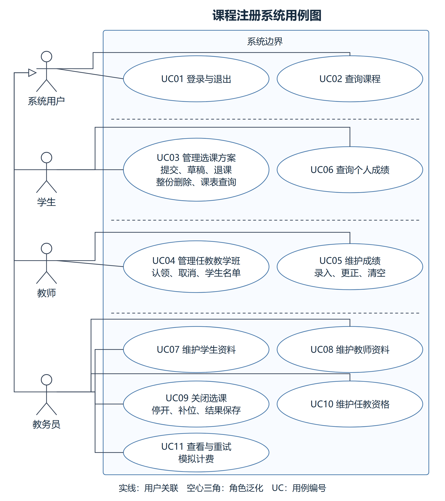

# 课程注册系统需求分析文档

初稿日期：2026-10-12；当前项目同步日期：2026-10-14。

小组共4人，分工见[开发计划第3节](课程注册系统开发计划.md#3-人员分工)。组号、成员信息和贡献比例统一填写在[工作总结第5.5节](课程注册系统工作总结.md#55-基本信息与贡献记录)。

## 1. 项目背景与目标

选课工作涉及课程查询、学生报名、教师任教和教务处理。如果这些信息分开记录，容易出现人数不一致、上课时间冲突和修改结果不同步的问题。

课程注册系统将这些操作集中到同一套网页中。学生查询课程并安排课表，教师认领教学班和维护成绩，教务员管理人员资料，在无有效学生选课会话时关闭选课。

系统应保证选课结果准确、角色权限清楚、操作反馈及时。学生提交后可以查看课表，教师可以查询本人教学班名单，教务员可以核对停开和备选补位结果。

当前版本实现课程注册、教师任教和教务管理的主要流程。计费计算学费并模拟发送，后台任务按间隔重试，也支持手动重试；课程目录使用本地数据库或JSON快照。

## 2. 用户与基本概念

### 2.1 用户角色

| 角色 | 使用目标 | 权限范围 |
| --- | --- | --- |
| 学生 | 查询课程、安排课表、查看成绩 | 只能修改自己的选课，查询自己的成绩 |
| 教师 | 确定任教班级、查看名单、维护成绩 | 只能操作本人任教范围内的记录 |
| 教务员 | 维护人员、安排资格、关闭选课、核对结果 | 管理学生与教师资料，执行教务功能 |

三种角色均需使用已启用的账号登录。系统根据登录身份检查权限，修改页面参数不能改变角色或操作范围。

### 2.2 基本概念

| 名称 | 含义 |
| --- | --- |
| 课程 | 教学内容的定义，如课程编号、名称、简介和所属院系 |
| 教学班 | 某门课程在某学期的具体开设，包含教师、地点、时间和容量 |
| 首选 | 学生正式选择的教学班，提交成功后占用名额 |
| 备选 | 按顺序保存的候补选择，提交时不占座，关课时可能用于补位 |
| 草稿 | 尚未正式提交的选课方案，可以不完整，不改变正式课表 |
| 关闭选课 | 无有效学生选课会话时由教务执行停开、补位和结果保存，完成后不再允许调整选课 |

同一课程可以有多个教学班，但一个学生的完整方案中不能重复选择同一课程。

## 3. 功能需求

| 编号 | 用户 | 主要功能 | 核心限制 |
| --- | --- | --- | --- |
| R01 | 三种角色 | 登录与退出 | 账号启用，密码正确，身份与角色匹配 |
| R02 | 三种角色 | 查询课程、详情、所属院系、教师、时间和名额 | 课程资料只读 |
| R03 | 学生 | 选课、草稿、退课、整份删除和课表查询 | 只能操作本人记录，修改受选课期限制 |
| R04 | 教师 | 认领、取消认领、教师课表和学生名单查询 | 有课程资格，只能取消本人主动认领的班，只能查本人课表与名单 |
| R05 | 教师、学生 | 录入、更正、清空、批量导入导出、统计、确认提交及查询成绩 | 教师维护本人授课成绩，修改留痕；学生只查本人 |
| R06 | 教务员 | 查找、新增、编辑和确认删除学生、教师资料 | 不管理教务员权限，有关联记录时拒绝删除，可通过编辑停用 |
| R07 | 教务员 | 关课、停开、补位、模拟计费和任教资格维护 | 关课须无有效学生选课会话；重复关课不重复处理 |

### 3.1 登录与课程查询

用户选择角色并输入账号、密码。系统自动识别数据库保存的是明文还是PHP密码哈希，分别按对应方式验证。正确登录后进入对应页面，错误密码、停用账号或角色不匹配时给出提示。退出后不能继续访问需要登录的页面。

课程查询支持按课程、教师和星期筛选。课程详情展示课程简介、院系和相关教学班信息；无匹配结果时提示用户调整条件。所属院系为空时显示“未填写”，演示院系仅为样例归属。

### 3.2 学生选课与课表

学生可保存草稿或正式提交0–4个首选和0–2个有顺序的备选，无需填满。空项不计入数量，提交空方案会释放原首选占座。系统检查课程数量、重复选择、先修条件、上课时间和剩余名额。

选课页面自动刷新剩余名额，也可手动刷新。已选首选班被其他学生占满时提示调整，不清空正在填写的方案；本人已占有名额的教学班仍可保留，满额班仍可作为备选。

成功后保存首选与备选，首选进入实际课表。学生可以在开放期退课或重新提交，退课后释放名额。确认整份删除时，清空本学期课表、备选和草稿。

课表应反映实际选课结果。重新登录后，数据库模式下的正式记录和草稿仍能读取，其他学生不能访问这些记录。

### 3.3 教师任教与成绩

教师查看待认领教学班，系统检查任教资格、已有教师、上课时间和冲突。认领成功后，该班归入教师的任教范围。

教师只能取消本人主动认领的班，不能取消他人认领或预先安排的任教。关闭选课后不能调整任教。

教师可以查看本人教学班课表，搜索或导出学生名单，并在选课已关闭、教学结束时间已到、班级确认开设后录入、修改、清空或通过CSV批量维护成绩。系统展示等级分布、未录入人数、通过率和折算平均分；全部学生完成录入后可确认提交。后续修改自动撤销确认并记录修改前后值、时间和来源。尚不满足录入条件的本人教学班应显示原因，学生在成绩页只查询本人已完成学期的结果。

### 3.4 教务管理

教务员维护学生和教师资料，包括查找、新增、编辑和删除确认。新增后生成编号，账号和证件号不能重复，编辑过期资料时应提示重新读取。

删除前展示完整资料并要求确认，取消删除保留原记录。没有业务历史的人员可以删除，其未提交草稿或任教资格在同一事务清理；有关联选课、授课、成绩或计费历史时拒绝删除并保留所有记录，教务员可在编辑页停用。停用或重置密码后原登录会话失效。

教务在“关闭选课”维护选课开始、截止和教学结束时间；开始早于截止，教学结束不早于截止。已关闭选课不能通过改日期重开；无录入或确认成绩时，可使用重新开启恢复关闭前快照并撤销关课结果及账单，默认开放7天。升级推定的旧学期结束时间须按实际安排核对。

教务员可授予或撤销课程任教资格。教师在未关闭学期中仍承担某课程时，不能撤销该课程资格。

### 3.5 人员资料字段

教务员维护学生和教师资料。系统编号自动生成，账号和证件号不能重复；已有账号不能更改，人员姓名及业务资料可以编辑。

| 字段 | 适用人员 | 要求 |
| --- | --- | --- |
| 系统编号 | 学生、教师 | 自动生成的唯一编号，不由页面填写或修改 |
| 登录账号 | 学生、教师 | 3—64位英文字母、数字、下划线、点或连字符，以字母或数字开头；创建后不可修改 |
| 姓名 | 学生、教师 | 必填，最多100个字符，不能含控制字符或首尾空白 |
| 出生日期 | 学生、教师 | 必填，合法日期，不晚于当天 |
| 证件号 | 学生、教师 | 必填，1—32位字母、数字或连字符，系统内唯一 |
| 人员状态 | 学生、教师 | 必填，最多32个字符，例如在读、毕业或在职；与账号是否启用分别记录 |
| 毕业日期 | 学生 | 必填，晚于出生日期；教师不填写 |
| 所属院系 | 教师 | 必填，最多100个字符；学生不填写教师院系 |
| 账号启用状态 | 学生、教师 | 启用或停用，停用后不能登录，已有业务记录保留 |
| 初始或重置密码 | 学生、教师 | 新建时必填，编辑时留空保持原值；8—72字节，不含空字符，保存为密码哈希 |

资料版本由系统维护，保存时用于识别过期编辑。字段长度与业务校验见[设计文档](课程注册系统设计文档.md)及人员维护实现。

## 4. 业务规则

### 4.1 选课规则

1. 方案允许0–4个首选和0–2个备选，无需填满。所选教学班不能重复，同一课程不能选择两个班，最终正式课程不超过4门。
2. 首选提交成功后占座，人数不能超过教学班容量，容量上限可配置为1—10人；最终开班至少需要3人，容量小于3人的班不能满足开班条件。备选不占座，可以登记满额班，实际补位时重新检查容量。
3. 新增首选或登记备选有先修要求时，学生必须具有符合条件的历史成绩，按课程代码匹配，不能用同名但不同代码的课程替代。保留原注册教学班不重复检查先修成绩；换班、改为备选或退课后重选仍须校验。先修关系以数据库中的最新关系为准。
4. 正式提交检查首选之间的全部上课时段，使用数据库秒级时间判断，端点完全相接不算冲突，即使仅重叠30秒也须拒绝。备选可以与首选时间冲突，实际补位时再与保留课表比较。
5. 方案提交失败时，整次修改不保存，原课表和人数保持完整。
6. 草稿只在开放期保存，最多4个首选、2个备选，可不完整或暂有冲突，但非空班级编号必须存在。草稿不占座，正式提交成功后清除，失败则保留。
7. 开放期允许退课、重选和确认整份删除，截止后拒绝这些修改。

开放期要求学期状态为开放，且开始时间 ≤ 当前时间 ≤ 截止时间，包含起止时刻。时间按北京时间处理，样例截止时间为2026年11月1日17:00，实际起止时间由数据库记录。

### 4.2 关闭选课规则

教务员在学期开放且没有有效学生选课会话时可发起关课，无需等待截止。学生退出登录或会话过期后释放限制，多浏览器会话分别计算。处理顺序如下：

1. 停开没有教师的教学班，释放相关占座。
2. 按学生保存方案的先后和编号处理空缺，依次尝试备选。
3. 补位后再停开仍不足3人的教学班。
4. 用剩余未尝试备选填补新出现的空缺。
5. 保存最终课表、教学班结果和备选尝试原因，关闭学期。

补位先后按学生当前保留方案的最早保存时间确定，相同时按学生编号排序。重新正式提交会刷新方案保存时间，保存草稿不影响先后。

每次补位都重新检查容量、先修、重复课程和时间冲突。每个备选最多尝试一次；已补入的班后来停开时，恢复相应备选记录并释放占座。没有合适备选时保留实际课表，不强行补足。

关课失败时全部恢复，重复关闭只显示已有结果，不再次分配名额。

### 4.3 成绩规则

成绩允许A、B、C、D、F、I或留空。A—D算先修通过，历史数据中的优秀、良好、中等、及格也算通过；F、I和空值不算通过。

教师只能修改本人已确认开设、选课已关闭且教学已结束的班级成绩。学生不能录入成绩，也不能查询其他学生或未完成学期的成绩。选课关闭与教学结束是两个阶段。

### 4.4 计费与课程目录

关课时按最终有效课程数量乘以每门课程单价计算学费，保存课程、单价及总额快照，关课保存完成后模拟发送。默认每门300元，单价可配置。发送失败保留账单、错误、尝试次数和下次重试时间，后台任务按设定间隔反复发送直到接收端可用，也支持教务员手动重试。成功记录不重复发送；重试不重新计算账单。学生可在最终课表查看账单，教务员可查看账单明细及发送结果。计费接口采用模拟接收方式，不包含真实支付或扣款。

课程定义支持从本地数据库或JSON快照读取，只读接口需要登录并只接受GET请求。接口不能修改课程，目录缺失或格式错误时给出受控提示。先修、任教和占座等业务记录由注册数据库管理。

## 5. 用例模型与主要操作

### 5.1 系统用例图

系统用户分为学生、教师和教务员。三种角色共用登录、退出和课程查询功能，其余操作按角色授权。图中的“系统用户”表示三种角色的共同身份，不是额外账号类型。登录是业务操作的前置条件，不在每个用例中重复画出。

图1 课程注册系统用例图。图中归纳用户目标，草稿、退课、整份删除和课表查询归入选课方案管理，取消认领和名单查询归入任教管理。细分操作见下列用例说明。

[矢量图](课程注册系统需求分析文档_media/课程注册系统用例图.svg)和[Mermaid关系源文件](课程注册系统需求分析文档_media/课程注册系统用例图.mmd)与本节一起维护。课程目录和计费接收端采用本地模拟方式，数据导入属于运行准备，不作为用户操作用例。

### 5.2 用例与需求对应

UC表示用户用例，R表示功能需求，T表示测试场景组。一个用例可以对应多个测试场景，编号之间不按数量等同。

| 用例 | 参与者 | 对应需求 | 测试场景组 |
| --- | --- | --- | --- |
| UC01 登录与退出 | 三种角色 | R01 | T01、T02、T13 |
| UC02 查询课程 | 三种角色 | R02 | T03、T21、T22 |
| UC03 管理选课方案 | 学生 | R03 | T04—T07、T16、T17 |
| UC04 管理任教教学班 | 教师 | R04 | T08、T18、T19 |
| UC05 维护成绩 | 教师 | R05 | T09 |
| UC06 查询个人成绩 | 学生 | R05 | T09、T02 |
| UC07 维护学生资料 | 教务员 | R06 | T10、T13 |
| UC08 维护教师资料 | 教务员 | R06 | T10、T13 |
| UC09 关闭选课 | 教务员 | R07 | T11、T12 |
| UC10 维护任教资格 | 教务员 | R07 | T19 |
| UC11 查看与重试模拟计费 | 教务员 | R07 | T20 |

详细测试步骤见[测试计划第4节](课程注册系统测试计划.md#4-详细测试场景)，实现与测试脚本对应关系见[测试计划第5节](课程注册系统测试计划.md#5-需求与测试入口对应)。

### 5.3 主要用例说明

除登录外，以下用例均要求用户已登录且账号启用。写入操作检查表单令牌，数据库模式下保存业务记录。无权限、非法输入或业务校验失败时提示原因，不保存部分修改。

#### UC01 登录与退出

- **参与者与前置条件**：学生、教师或教务员；已有对应角色的账号。
- **基本流程**：选择角色并输入账号、密码 → 系统核对账号状态、角色和密码 → 建立会话并显示角色首页 → 用户退出时清除会话。
- **异常流程**：账号、密码或角色不匹配，以及账号停用时，提示登录失败；已登录账号被停用或重置密码后，再次访问时要求重新登录。
- **后置条件**：登录成功后只能访问本角色允许的功能；退出后业务页面重新要求登录。

#### UC02 查询课程

- **参与者与前置条件**：三种角色；课程目录可以读取。
- **基本流程**：打开课程列表 → 按课程、教师或星期筛选 → 查看课程详情及教学班的教师、时间、地点和名额。
- **异常流程**：无匹配结果时提示调整条件；课程不存在或目录读取失败时给出受控提示。
- **后置条件**：返回查询结果，课程定义和选课记录保持不变。只读目录接口提供相同课程定义的JSON表示。

#### UC03 管理选课方案

- **参与者与前置条件**：学生；修改操作处于选课开放期。
- **基本流程**：查看课程 → 填写0–4个首选、0–2个有顺序的备选 → 正式提交 → 系统检查数量、课程重复、先修、首选时间与名额 → 保存方案及首选占座 → 提示保存成功，学生可查看课表。
- **其他操作**：保存草稿时只保存待编辑内容，不占座；退课时移除本人某个首选及有效占座；确认整份删除时清空本学期方案、草稿并释放全部有效占座。重新提交完整方案时替换原方案，已有占座不重复计算。
- **异常流程**：输入不合法、先修不足、首选满额或时间冲突时拒绝保存；名额刷新发现首选满额时保留输入并提示调整，提交时仍重新校验；期外拒绝修改。未确认整份删除时保留记录。
- **后置条件**：正式提交成功后，首选进入课表、备选仅保存顺序、草稿清除；失败时原方案、占座和草稿保持不变。课表查询不受开放期限制。

#### UC04 管理任教教学班

- **参与者与前置条件**：教师；认领或取消认领处于选课开放期。
- **基本流程**：查看待认领教学班 → 选择一个班 → 系统核对课程资格、已有教师及全部上课时段 → 保存任教与主动认领记录 → 教师查看任教列表及本班学生名单。
- **其他操作**：教师可取消本人主动认领的教学班，成功后该班恢复待认领状态；查询名单只显示本人教学班的有效选课学生。
- **异常流程**：无资格、已有教师、时间缺失或冲突时拒绝认领；他人任教或预先安排的班不能取消；学期关闭后不能调整任教；他人教学班名单不允许访问。
- **后置条件**：教师安排和主动认领记录一致；被拒绝的操作不改变原任教关系。

#### UC05 维护成绩

- **参与者与前置条件**：任课教师；选课已关闭、教学结束时间已到，教学班确认开设，学生有该班有效选课记录。
- **基本流程**：进入本人成绩录入页面 → 选择学生 → 输入允许的等级 → 保存 → 系统检查任教关系与成绩值并写入。
- **其他操作**：更正时更新同一成绩记录；清空时将成绩保存为空，保留选课关系。
- **异常流程**：非法等级、他人班级或无效选课记录均拒绝；选课未关闭、教学未结束或停开教学班不能录入成绩。
- **后置条件**：学生可查询最新成绩；清空后不再显示原等级；保存失败保留原成绩。

#### UC06 查询个人成绩

- **参与者与前置条件**：学生。
- **基本流程**：打开成绩页面 → 系统根据会话中的学生身份读取已完成学期有效选课对应的成绩 → 按学期和课程显示结果。
- **异常流程**：没有成绩时显示空状态；页面参数不能用来查询其他学生成绩。
- **后置条件**：学生只能看到自己的成绩，数据不发生修改。

#### UC07 维护学生资料

- **参与者与前置条件**：教务员；数据库模式。
- **基本流程**：进入学生资料管理 → 查找记录或选择新增 → 填写账号、姓名、出生日期、证件号、状态、毕业日期和启用状态等资料 → 系统检查格式及唯一性 → 保存并返回结果。
- **其他操作**：编辑已有资料、停用账号或重置密码；删除需确认。创建后账号不再更改，编辑时密码留空保留原值。
- **异常流程**：账号或证件号重复、字段不合法或资料版本过期时拒绝保存；有关联业务记录时拒绝删除，取消删除保留原记录。
- **后置条件**：资料保存完整；新增或重置密码使用哈希，停用或重置密码后旧会话失效；失败不改变原记录。

#### UC08 维护教师资料

- **参与者与前置条件**：教务员；数据库模式。
- **基本流程**：进入教师资料管理 → 查找记录或选择新增 → 填写账号、姓名、出生日期、证件号、状态、所属院系和启用状态等资料 → 系统检查格式及唯一性 → 保存并返回结果。
- **其他操作**：编辑、停用、重置密码和确认删除，处理规则与学生资料相同；教师填写所属院系，不填写毕业日期。
- **异常流程**：重复资料、非法字段或过期编辑拒绝保存；存在任教等关联记录时拒绝删除。
- **后置条件**：教师资料与账号保持一致；本用例不授予课程任教资格，资格由UC10单独维护。

#### UC09 关闭选课

- **参与者与前置条件**：教务员；数据库模式，学期开放且无有效学生选课会话。
- **基本流程**：发起关课 → 停开无教师教学班 → 按方案先后及备选顺序补位 → 停开仍不足3人的教学班 → 用剩余备选再次补位 → 保存最终课表、原因及计费快照 → 关闭学期并提交事务 → 模拟发送计费记录。
- **异常流程**：存在有效学生选课会话时拒绝关课；备选不符合条件时记录原因并继续处理，可用课程不足时保留实际课表；事务失败则恢复原数据；已关闭学期的重复请求只读取已有结果。
- **后置条件**：学期关闭，学生和教师不能再调整选课或任教；最终人数与课表一致。模拟发送失败保留重试记录，不撤销关课结果。

#### UC10 维护任教资格

- **参与者与前置条件**：教务员；数据库模式，指定教师和课程存在。
- **基本流程**：选择教师与课程 → 授予或撤销资格 → 系统检查对象与现有任教情况 → 保存结果。
- **异常流程**：教师在未关闭学期中仍承担该课程时拒绝撤销；无权操作或对象不存在时拒绝修改。
- **后置条件**：教师认领按更新后的资格检查，已有任教关系不会因撤销失败而改变。

#### UC11 查看与重试模拟计费

- **参与者与前置条件**：教务员；数据库模式，关课已生成计费快照。
- **基本流程**：查看模拟发送状态 → 发起重试 → 系统选择可发送记录 → 模拟发送并保存结果、尝试次数。
- **异常流程**：模拟接收失败时保留记录；已成功记录不重复发送；重复请求不生成重复快照。
- **后置条件**：可核对账单金额、发送状态与重试结果；失败保留到期重试信息，成功不重复发送，不产生真实支付。

## 6. 使用与数据要求

页面应提供明确的操作入口和结果提示，错误信息应说明用户可以调整的内容。课程、表单和课表在常见窗口宽度下应可阅读，键盘操作和窄屏布局需人工检查。

多人共享的名额和业务记录由数据库保存。未配置数据库用户时使用会话演示模式，数据保存在登录会话中，用于课程查询、选课和认领演示。

密码字段支持明文和PHP密码哈希，登录成功后保留原存储值，不自动转换。明文按原值匹配，哈希通过密码验证函数检查，不能把哈希字符串当作登录密码。教务只能查看密码状态，不展示或回填明文及哈希值，编辑时留空保留原值。新增或重置时保存PHP密码哈希，重置后旧会话失效。

数据库异常不能直接泄露内部连接信息。修改失败不能导致人数和记录不一致，重复操作不能重复占座或重复关课。

## 7. 验收要求

| 检查内容 | 通过要求 |
| --- | --- |
| 登录与权限 | 明文和哈希账号均可登录，登录不改变密码存储值，错误或越权操作被拒绝 |
| 课程查询 | 筛选与详情正确，院系信息按资料显示 |
| 学生选课 | 数量和业务限制生效，人数不超限，失败无部分记录 |
| 草稿与删除 | 草稿不占座且隔离，确认删除释放名额并清空相关记录 |
| 教师与成绩 | 资格和任教限制生效，只能维护本人范围内数据 |
| 人员管理 | 重复资料拒绝，删除确认和关联保护有效 |
| 关课与计费 | 顺序正确，可重复查询，失败可恢复，成功发送不重复 |
| 数据保存 | 数据库模式下重新登录后记录仍存在 |
| 页面使用 | 主要操作、键盘和窄屏显示通过人工检查 |

验收包括功能、权限、数据保存和页面操作。具体场景见[测试计划](课程注册系统测试计划.md)，执行结果见[测试报告](课程注册系统测试报告.md)。

## 8. 原题要求与方案说明

下表说明原题功能在本项目中的处理方式。

| 原题要求 | 方案说明 |
| --- | --- |
| 登录及角色权限 | 支持学生、教师、教务员登录，按身份限制操作 |
| 原题4个首选、2个备选，现按确认规则允许最多4+2，开放期内修改或删除方案 | 首选占座，备选记录顺序；支持草稿、退课、重提和确认整份删除 |
| 教学班最多10人、至少3人 | 保存时检查容量，关课时停开无教师或补位后不足3人的班 |
| 教师选择任教教学班并查看名单 | 按资格认领、取消本人主动认领，检查时间冲突并查询本人名单 |
| 教师录入或更正成绩，学生查询成绩 | 支持A、B、C、D、F、I及清空，按任教关系和学生身份检查权限 |
| 维护学生和教师资料 | 新增、查找、编辑和确认删除，关联保护及停用 |
| 无有效学生选课会话时关闭选课并按备选补位 | 在事务中完成停开、补位、结果保存和最终课表确认 |
| 只读访问原有课程目录 | 用本地数据库或JSON快照提供只读课程信息，作为目录接口的模拟数据源 |
| 计算学费并发送计费事务 | 按最终课程数量和统一单价计算学费，模拟发送课表与金额快照；未接入真实财务系统 |
| 计费失败后按间隔自动重试 | 保留失败账单和下次发送时间，启用后台任务后按间隔重试，也支持手动重试 |
| 编排课表期间教学班满额时通知学生 | 编辑页面定时刷新名额，首选满额时提示调整；本人已占座和满额备选保留，提交时重新检查 |

原题中的性能参考指标包括中央数据库2000并发用户、本地服务器500并发用户、目录访问不超过10秒、80%事务在2分钟内完成，以及全天候运行、停机时间不超过10%。这些指标通过并发请求、耗时统计和运行日志评估，与功能检查分别记录。

原题包含Windows桌面界面约束，课程设计要求允许PHP等Web方案，本项目采用浏览器访问。

## 9. 界面与验证状态

页面保留核心操作、数量、时间和错误提示，删除重复说明；课表的账单课程明细、关闭结果、备选处理按需展开。教学班停开或递补等业务结果仍可查询。

截至2026年10月14日，当前代码提交`73b5336`已完成独立临时MySQL、PHP服务及会话目录中的完整回归：39个阶段、1067项检查全部通过，退出码0，最后一席竞争执行5轮。该回归覆盖页面精简后的实现，以及先修课、秒级时间冲突和数据库连接复用修复；其中先修与时间边界13项、HTTP连接检查15项均通过。PHP服务日志无Warning、Notice、Fatal error或未处理异常。浏览器人工操作、键盘、窄屏视觉验收和大规模性能测试仍未完成。完整记录见[最新自动检查记录](tests/function_audit_regression.json)，新增边界明细见[边界检查记录](tests/function_audit_boundaries.json)。
